<div align="center">

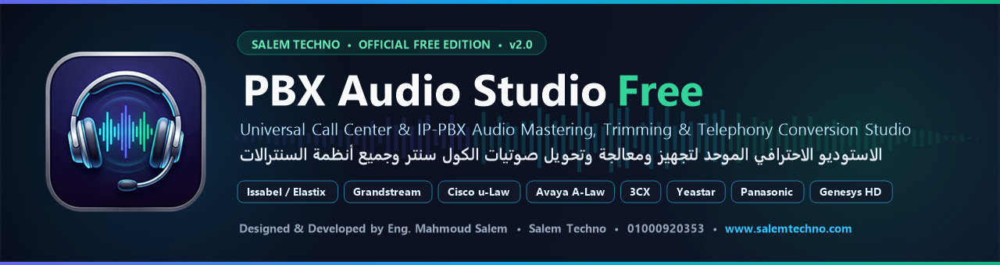

<br /><br />

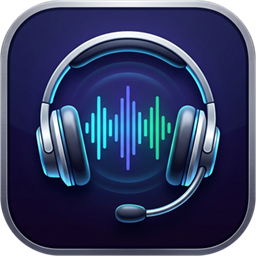

# 🎧 PBX Audio Studio Free
### **Universal Call Center & IP-PBX Audio Mastering, Trimming & Telephony Conversion Studio**
### **الاستوديو الاحترافي الموحد لتجهيز ومعالجة وتحويل صوتيات الكول سنتر وجميع أنظمة السنترالات**

**تصميم وبرمجة: مهندس محمود سالم (Eng. Mahmoud Salem) — [شركة سالم تيكنو | Salem Techno](https://www.salemtechno.com)**  
📞 **الهاتف / واتساب (Phone / WhatsApp):** [`01000920353`](https://wa.me/201000920353) (`+201000920353`) &nbsp;|&nbsp; 🌐 **الموقع الرسمي (Official Website):** [www.salemtechno.com](https://www.salemtechno.com)

<br />

<!-- Row 1: Core Capabilities & Edition Badges -->
<p align="center">
  
  
  
  
  
</p>

<!-- Row 2: Direct Download & Contact Action Badges -->
<p align="center">
  <a href="https://github.com/SalemTechno/PBX-Audio-Studio-Free/raw/main/1_Portable_Edition/PBX%20Audio%20Studio%20Free.exe">
    
  </a>
  <a href="https://github.com/SalemTechno/PBX-Audio-Studio-Free/raw/main/2_Documentation_and_Guide/PBX_Audio_Studio_Free_Guide_HTML5.html">
    
  </a>
  <a href="https://github.com/SalemTechno/PBX-Audio-Studio-Free/archive/refs/heads/main.zip">
    
  </a>
</p>

<p align="center">
  <a href="https://www.salemtechno.com">
    
  </a>
  <a href="https://wa.me/201000920353">
    
  </a>
</p>

<!-- Row 3: Quick Section Navigation Pills -->
<p align="center">
  <a href="#downloads"></a>
  <a href="#pbx-matrix"></a>
  <a href="#features"></a>
  <a href="#visual-guide"></a>
  <a href="#quickstart"></a>
  <a href="#contact"></a>
</p>

</div>

---

## 📖 نبذة تعريفية شاملة | Executive Overview (Arabic & English)

> [!IMPORTANT]
> **🇪🇬 نبذة عن البرنامج (العربية):**  
> **`PBX Audio Studio Free`** هو استوديو سطح مكتب احترافي متكامل وفائق السرعة يعمل بملف تنفيذي واحد مستقل (**بدون تثبيت وبدون أي إضافات خارجية**)، صُمم خصيصاً لمهندسي أنظمة الـ VoIP والـ IP-PBX وإدارات الكول سنتر وفرق الدعم الفني لتجهيز وهندسة وقص ودمج وتحويل كافة الملفات الصوتية (رسائل الترحيب، الرد الآلي **IVR**، موسيقى الانتظار **Music on Hold**، ورسائل الطوابير **Queues**) بالصيغ والهيدرات الرسمية المعتمدة تماماً لجميع أنظمة السنترالات العالمية: **`Issabel 5` / `Elastix` / `FreePBX` / `Asterisk`**، **`Grandstream UCM`**، **`Cisco CUCM / UCCX / Unity`**، **`Avaya Aura / CM / IP Office`**، **`3CX`**، **`Yeastar`**، **`Panasonic KX-NS / TDE`**، و**`Genesys Cloud / MS Teams / Zoom Phone`** — بصوت هاتفي فائق النقاء والوضوح مع إزالة الضوضاء الطيفية (`Spectral Denoise`) ومزج الموسيقى التلقائي (`Auto-Ducking`) والتحويل الدفعي متعدد الأنوية.

> [!NOTE]
> **🇬🇧 Executive Overview (English):**  
> **`PBX Audio Studio Free`** is an ultra-fast, zero-dependency, single-file standalone Windows desktop audio engineering studio purpose-built for **Call Center Engineers, VoIP Architects, and IP-PBX Administrators**. It transforms any audio file (`MP3, WAV, M4A, AAC, OGG, OPUS, FLAC, WMA`) or live microphone recording into broadcast-clear, zero-clipping telephony prompts tailored to the exact official container headers and codecs required by **`Issabel 5 / Elastix / Asterisk`**, **`Grandstream UCM`**, **`Cisco CUCM / UCCX / Unity`**, **`Avaya Aura / IP Office`**, **`3CX`**, **`Yeastar`**, **`Panasonic`**, and **`Genesys / HD SIP`** — complete with a full bilingual **Arabic (RTL) & English (LTR)** interface, Dark & Light themes, precision waveform trimming, built-in corporate background music with **Auto-Ducking**, **STFT Spectral Denoise**, **IVR Clips Manager**, and **Multi-Core Batch Conversion**.

> [!TIP]
> 🔒 **ملاحظة الخصوصية والبيانات التجريبية | Privacy & Synthetic Demo Data Notice:**  
> جميع لقطات الشاشة والملفات الصوتية وأسماء المقاطع والمسارات المعروضة في هذا الدليل (`C:\Demo_PBX_Prompts\Output`, `demo_ivr_welcome_ar.wav`, `demo_cisco_greeting_en.wav`, `demo_corporate_hold.wav`) تم إعدادها باستخدام **بيانات وصوتيات تجريبية وهمية بالكامل (100% Synthetic Demo Data)** حفاظاً على الخصوصية التامة.

---

<a id="downloads"></a>
## 📦 التحميل المباشر وهيكل المجلدات | Direct Downloads & Repository Structure

**🇪🇬 العربية:** يعمل البرنامج كملف تنفيذي واحد مستقل محمول (**Portable Single EXE**) بحجم خفيف (`1.98 MB` فقط) بدون الحاجة لتثبيت أي حزم خارجية، ومزود بحماية بصمة التحقق الرقمية (`SHA-256`):  
**🇬🇧 English:** Distributed as a single, self-contained, zero-install **Portable Executable (`1.98 MB`)** with embedded icon/logo and cryptographic `SHA-256` self-integrity protection:

| المجلد / الحزمة (Folder / Package) | الوصف الكامل بالعربية والإنجليزية (Bilingual Description) | الحجم (Size) | التحميل المباشر (1-Click Download) |
| :--- | :--- | :---: | :---: |
| 📂 [**`1_Portable_Edition`**](./1_Portable_Edition/) | **🇪🇬 النسخة المحمولة الرسمية (`Portable Single EXE`):** ملف واحد مستقل بالكامل بالأيقونة واللوجو المدمجين — تشغيل فوري بدون تثبيت.<br/>**🇬🇧 Official Standalone Portable EXE:** Zero-install, zero-dependency single file with embedded icon & SHA-256 integrity seal. | `1.98 MB` | [](https://github.com/SalemTechno/PBX-Audio-Studio-Free/raw/main/1_Portable_Edition/PBX%20Audio%20Studio%20Free.exe) |
| 📂 [**`2_Documentation_and_Guide`**](./2_Documentation_and_Guide/) | **🇪🇬 الدليل التفاعلي المصور (`Offline HTML5 Guide`):** دليل استخدام شامل بالعربية والإنجليزية يعمل بدون إنترنت مع كافة الصور.<br/>**🇬🇧 Offline Interactive HTML5 Guide:** Self-contained bilingual visual user manual with embedded full-resolution screenshots. | `2.57 MB` | [](https://github.com/SalemTechno/PBX-Audio-Studio-Free/raw/main/2_Documentation_and_Guide/PBX_Audio_Studio_Free_Guide_HTML5.html) |
| 📂 [**`3_Screenshots_and_Assets`**](./3_Screenshots_and_Assets/) | **🇪🇬 معرض الصور والشعارات الرسمية:** 11 لقطة شاشة كاملة الدقة باللغتين العربية والإنجليزية والوضع الداكن والفاتح (ببيانات وهمية).<br/>**🇬🇧 Official Screenshots & Brand Gallery:** 11 full-resolution synthetic-data UI captures + official logo & brand banner. | `13 Assets` | [](./3_Screenshots_and_Assets/) |
| 📦 **`Full Repository Archive`** | **🇪🇬 الحزمة الكاملة المضغوطة (`Full ZIP`):** تحميل البرنامج والدليل المصور وجميع الصور في ملف واحد.<br/>**🇬🇧 Complete All-in-One ZIP:** Downloads the Portable EXE, Offline HTML5 Guide, License, and all visual assets together. | `~6.0 MB` | [](https://github.com/SalemTechno/PBX-Audio-Studio-Free/archive/refs/heads/main.zip) |

**🔐 بصمة التحقق الرقمية (`SHA-256 Checksum` — `PBX Audio Studio Free.exe`):**
```text
5834DF805B2B3C104C512FAC9A1B95AD3F21F5720E85B11D7365FEAC059D78C7
```

---

<a id="pbx-matrix"></a>
## ☎️ أنظمة الكول سنتر والسنترالات المدعومة | Supported Call Center & IP-PBX Systems

بمجرد اختيار ماركة السنترال من لوحة الأنظمة داخل البرنامج، يقوم **`PBX Audio Studio Free`** تلقائياً بضبط **الصيغة الرسمية المعتمدة والهيدر الدقيق (`RIFF/fmt/fact/data`) ومعالجة التردد والصوت** المطابقة لمتطلبات المصنّع (مع إمكانية اختيار أي صيغة من الصيغ الـ 7 يدوياً في أي وقت):

| ماركة النظام (IP-PBX / Call Center Brand) | الصيغة الرسمية التلقائية (Auto Official Format) | المواصفات الفنية والهيدر (Exact Technical Header) | مسار الرفع داخل النظام (PBX Upload Path) |
| :--- | :---: | :--- | :--- |
| **Issabel 5 / Elastix / FreePBX / Asterisk** | **`WAV 8k PCM`** | Canonical 44-byte RIFF WAV • `16-bit PCM` • `8000 Hz` • `Mono` (+ `.alaw` / `.ulaw` / `.sln`) | `PBX → System Recordings` / `Music on Hold` |
| **Grandstream UCM (`UCM62xx / UCM63xx`)** | **`WAV 8k PCM`** | Canonical 44-byte RIFF WAV • `16-bit PCM` • `8000 Hz` • `Mono` (`< 5 MB` compliant) | `PBX Settings → Voice Prompt → Custom Prompt` |
| **Cisco (`CUCM / UCCX / Unity Connection`)** | **`WAV u-Law`** | Official 58-byte RIFF WAV • **CCITT μ-Law (`0x0007`)** • `8-bit` • `8000 Hz` • `Mono` (`64 kbps` + `fact` chunk) | `UCCX Prompt Management` / `Unity Greetings` / `CUCM MOH` |
| **Avaya (`Aura / CM / IP Office`)** | **`WAV A-Law`** | Official 58-byte RIFF WAV • **CCITT A-Law (`0x0006`)** • `8-bit` • `8000 Hz` • `Mono` (+ `WAV u-Law` / `WAV 8k PCM`) | `VAL Announcements (Aura)` / `Voicemail Pro (IP Office)` |
| **3CX Phone System** | **`WAV 8k PCM`** | Strict 44-byte RIFF WAV • `16-bit PCM` • `8000 Hz` • `Mono` | `Digital Receptionist` / `Call Queues` / `Music on Hold` |
| **Yeastar (`P-Series / S-Series`)** | **`WAV 8k PCM`** | Canonical 44-byte RIFF WAV • `16-bit PCM` • `8000 Hz` • `Mono` | `PBX Settings → Voice Prompt → Custom Prompts` |
| **Panasonic (`KX-NS / KX-TDE / KX-HTS`)** | **`WAV 8k PCM`** | Canonical 44-byte RIFF WAV • `16-bit PCM` • `8000 Hz` • `Mono` (or `WAV G.711` for DISA OGM / BGM) | `DISA OGM` / `Voice Message / BGM Upload` |
| **Genesys Cloud / MS Teams / Zoom / HD SIP** | **`WAV 16k HD`** | Canonical 44-byte Wideband HD WAV • `16-bit PCM` • `16000 Hz` • `Mono` | `Architect Prompts` / `Auto Attendant Audio` |

---

<a id="features"></a>
## ✨ أهم مميزات الاستوديو الاحترافي | Complete Feature Summary

1. **🌐 واجهة كاملة باللغتين العربية والإنجليزية (`Full Arabic RTL + English LTR`) مع وضع داكن وفاتح:**  
   تبدأ شاشة الترحيب بخيار مباشر لفتح **النسخة العربية الكاملة (يمين-ليسار)** أو **النسخة الإنجليزية الكاملة (يسار-يمين)**، مع زر تبديل فوري بين اللغتين وبين الوضع الداكن (`Dark Studio`) والوضع النهاري (`Light Studio`) في الشريط العلوي النحيف.
2. **🎯 اختيار الماركة بضغطة واحدة + 4 أوضاع استخدام ذكية (`Welcome / IVR / MoH / Queue`):**  
   يضبط تلقائياً مستوى الصوت المستهدف (`Loudness`)، وترددات الصفاء الصوتي، والصيغة الرسمية للسنترال، مع تنظيف تلقائي لأسماء الملفات إلى حروف إنجليزية وأرقام و`_` لضمان قبولها فوراً على أنظمة لينكس والسنترالات.
3. **✂️ محرر موجة صوتية احترافي بالقص الدقيق (`Precision Waveform Editor`):**  
   استيراد أي ملف صوتي (`MP3, WAV, M4A, AAC, OGG, OPUS, FLAC, WMA`) بالسحب والإفلات أو **التسجيل المباشر من المايكروفون**، مع مقبضي «بداية» و«نهاية»، تكبير/تصغير بعجلة الماوس، قص، حذف الجزء الأوسط، إزالة الصمت التلقائي، رفع/خفض `+3dB / -3dB`، وتراجع/إعادة متعدد الخطوات (`Ctrl+Z / Ctrl+Y`).
4. **🎚️ محرك هندسة صوتية هاتفي متقدم (`Pro Telephony DSP Mastering Chain`):**  
   يشمل إزالة الضوضاء الطيفية أثناء الكلام (`STFT Spectral Denoise`)، معادل وضوح الحروف الهاتفي (`Telephony Clarity EQ @ 2.35 kHz`)، فلتر إزالة الهمهمة (`High-Pass Filter`)، بوابة عزل الصمت (`Noise Gate`)، ضاغط ديناميكي ناعم (`Soft Compressor`)، وحماية `True-Peak Limiter (-1.0 dBFS)` لضمان **صوت قوي وواضح مع `0%` تشويه (Clipping)**.
5. **🎵 موسيقى خلفية مدمجة ومزج ذكي تلقائي (`Background Music + Auto-Ducking`):**  
   أضف ملف موسيقى خاص بك أو ولّد إحدى **المقطوعات المؤسسية المدمجة** (`هادئة` / `إيقاع` / `استراحة`) مع خفض تلقائي ناعم لمستوى الموسيقى أثناء الكلام (`Auto-Ducking`) وضبط المقدمة (`Intro`) والخاتمة (`Outro`) والتلاشي (`Fade Out`) والتكرار التلقائي.
6. **🎧 معاينة فورية مقارنة (`A/B Instant Audition — PBX Output vs. Original`):**  
   استمع للصوت كما سيُسمع تماماً على خط الهاتف والسنترال قبل الحفظ، وقارن لحظياً بين مواصفات الملف الأصلي ومواصفات الملف النهائي (التردد، العلوّ، الذروة، الحجم الفعلي، المدة).
7. **📑 مدير مقاطع الـ IVR (`Saved IVR Clips Manager`):**  
   سجّل جميع رسائل الشركة في ملف صوتي واحد، ثم قسّمه واحفظ كل رسالة كمقطع مستقل (`01_welcome_main`, `02_sales_dept`, `03_support_queue`) وصدّرها جميعاً دفعة واحدة بضغطة زر.
8. **⚡ تحويل دفعي فائق السرعة متعدد الأنوية (`Multi-Core Batch Conversion`):**  
   حوّل عشرات الملفات الصوتية بالتوازي عبر جميع أنوية المعالج بنفس إعدادات الماركة والماسترينج المختارة في ثوانٍ معدودة.
9. **🟢 شريط تقدم أخضر حي ونسبة مئوية فورية (`Real-Time Emerald Progress Bar 0%–100%`):**  
   يعمل التحميل والمعالجة والتصدير في الخلفية بدون أي تجمّد للواجهة مع شريط تحميل أخضر متحرك ونسبة مئوية دقيقة وزر إلغاء فوري.
10. **🪶 خفيف جداً ومقاس نافذة ثابت مريح (`1080×700`):**  
    يفتح فورياً في أجزاء من الثانية باستهلاك ذاكرة ضئيل جداً (~`35 MB RAM` فقط) وبنافذة ثابتة منسقة بشريط عنوان مدمج ونحيف.

---

<a id="visual-guide"></a>
## 🖼️ الشرح المصور الكامل لجميع شاشات الاستوديو (11 شاشة ببيانات تجريبية وهمية)
## Complete Screen-by-Screen Visual Guide (All 11 Screens — 100% Synthetic Demo Data)

---

### 🔹 شاشة (`S-01`): شاشة الترحيب واختيار لغة النسخة | Welcome & Interface Language Picker

<div align="center">
  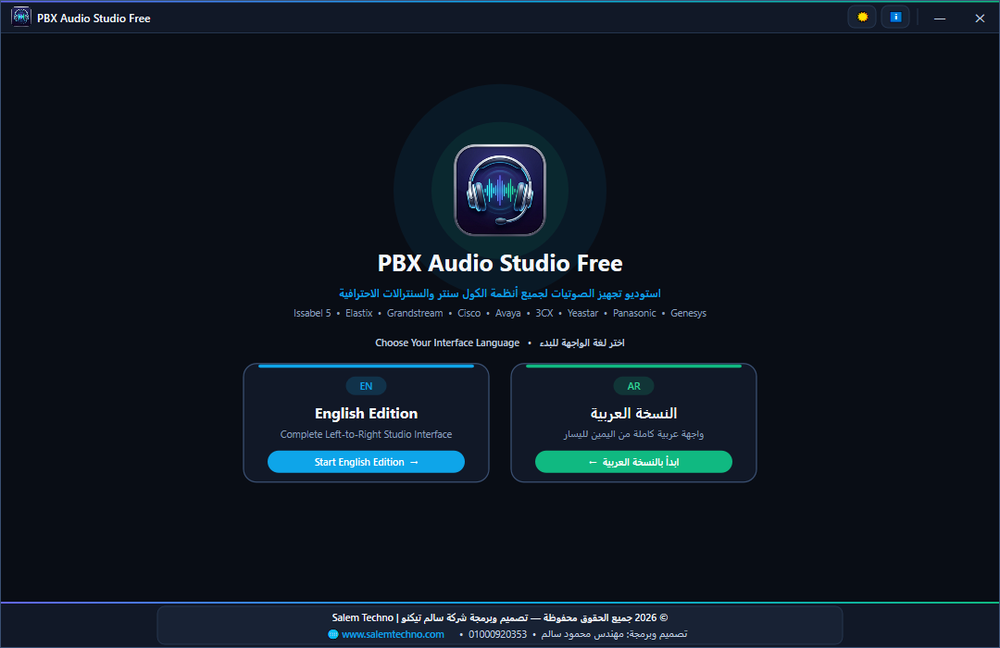
</div>

- **🇪🇬 الشرح بالعربية:**
  - عند تشغيل **`PBX Audio Studio Free`** تظهر شاشة ترحيب أنيقة تعرض الشعار الاحترافي الجديد (سماعة الكول سنتر والموجات الصوتية) مع قائمة الأنظمة المدعومة.
  - اختر **`النسخة العربية`** لفتح واجهة عربية كاملة من اليمين لليسار (`RTL`)، أو **`English Edition`** لفتح واجهة إنجليزية كاملة من اليسار لليمين (`LTR`) — مع إمكانية التبديل بين اللغتين في أي وقت من الشريط العلوي.
  - يعرض الفوتر بالأسفل بطاقة حقوق الملكية الرسمية في المنتصف (**شركة سالم تيكنو | Salem Techno — مهندس محمود سالم**) مع رابط مباشر قابل للنقر للموقع الرسمي.
- **🇬🇧 English Description:**
  - Launches into a clean, instant-load welcome screen showcasing the call-center headset + soundwave emblem and supported PBX platforms.
  - Click **النسخة العربية** for the full Right-to-Left Arabic edition or **English Edition** for the full Left-to-Right English interface (switchable anytime from the slim top bar).

---

### 🔹 شاشة (`S-02`): واجهة الاستوديو العربية ومحرر الموجة الصوتية (`Issabel / Elastix`) | Arabic RTL Studio & Waveform Editor

<div align="center">
  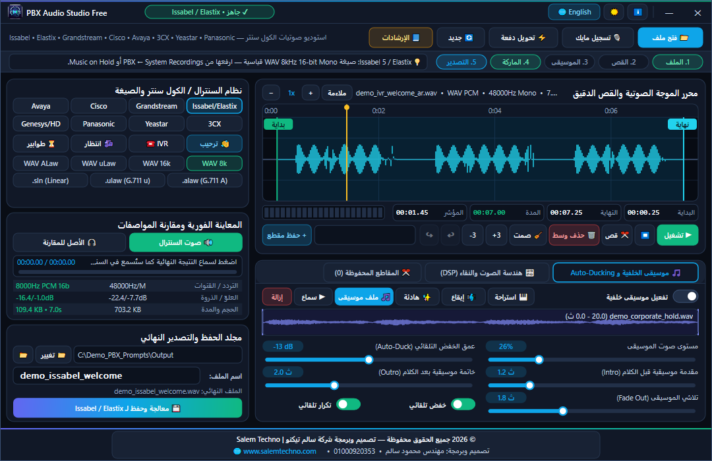
</div>

- **🇪🇬 الشرح بالعربية:**
  - **الشريط العلوي النحيف:** يعرض الأيقونة المصغرة واسم البرنامج ومؤشر الحالة الأخضر المباشر (`✓ جاهز • Issabel / Elastix`) وزر التبديل الفوري للغة (`🌐 English`) وتبديل الوضع الداكن/الفاتح ونافذة «حول البرنامج» (`ℹ`).
  - **شريط الخطوات الموجه (`1. الملف ← 2. القص ← 3. الموسيقى ← 4. الماركة ← 5. التصدير`):** يرشدك بصرياً لكل خطوة مع شريط نصيحة ذكية يوضح مسار الرفع الرسمي داخل السنترال المختار.
  - **محرر الموجة الصوتية (يمين):** يعرض موجة الصوت التجريبي (`demo_ivr_welcome_ar.wav`) مع مقبضي **`بداية`** و**`نهاية`**، مؤشر التشغيل الأصفر، مقياس مستوى الصوت (`VU Meter`)، وأدوات القص الدقيق، حذف الجزء الأوسط، إزالة الصمت التلقائي، تعديل الصوت `+3/-3 dB`، والتراجع/الإعادة.
  - **لوحة السنترال والمعاينة والتصدير (يسار):** اختيار من بين **8 ماركات كول سنتر** و**4 أوضاع استخدام** و**7 صيغ هاتفية**، مع مقارنة فورية بين مواصفات الأصل (`48000Hz/M • 703.2 KB`) والنتيجة النهائية (`8000Hz PCM 16b • 109.4 KB • -1.0 dB Peak`)، ومجلد الحفظ التجريبي (`C:\Demo_PBX_Prompts\Output`).
- **🇬🇧 English Description:**
  - Complete Right-to-Left Arabic workspace featuring the 5-step guided workflow bar, live interactive waveform with draggable Start/End pins, real-time Original vs. PBX spec comparison (`8000Hz PCM 16b • 109.4 KB`), and one-click export button tailored to the active PBX brand.

---

### 🔹 شاشة (`S-03`): النسخة الإنجليزية الكاملة مع نظام `Cisco CUCM / UCCX` (`WAV u-Law 0x0007`) | English LTR Studio — Cisco Mode

<div align="center">
  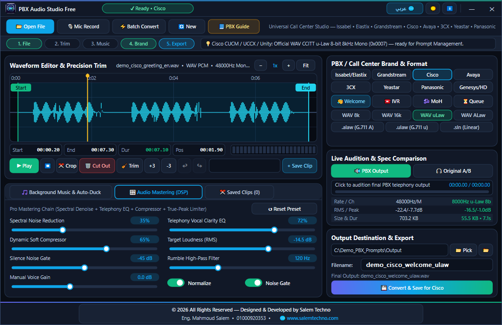
</div>

- **🇪🇬 الشرح بالعربية:**
  - استعراض **النسخة الإنجليزية الكاملة (`LTR`)** بعد الضغط على زر **`🌐 English`** في الشريط العلوي، مع اختيار ماركة **`Cisco`**.
  - لاحظ التحوّل التلقائي الفوري للصيغة الرسمية المعتمدة لسنترالات سيسكو: **`WAV uLaw` (`8000Hz u-Law 8b` — كود `0x0007` مع `fact` chunk بحجم `55.5 KB` فقط)** وظهور رسالة التوجيه الخاصة بـ `Cisco CUCM / UCCX / Unity Connection` في الشريط العلوي وزر الحفظ **`Convert & Save for Cisco`**.
- **🇬🇧 English Description:**
  - Complete Left-to-Right English interface switched instantaneously from the titlebar. Selecting **Cisco** automatically engages official **`WAV CCITT u-Law 8-bit 8000 Hz Mono (0x0007)`** encoding with `fact` chunk compliance (`55.5 KB` output) and updates the export CTA to **`Convert & Save for Cisco`**.

---

### 🔹 شاشة (`S-04`): الوضع النهاري الاحترافي (`Light Theme`) مع نظام `Grandstream UCM` | Professional Light Theme — Grandstream IVR

<div align="center">
  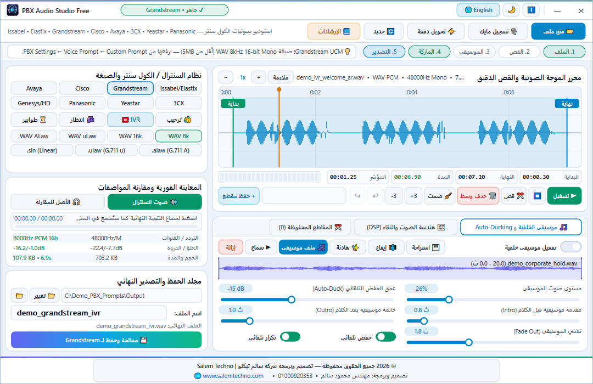
</div>

- **🇪🇬 الشرح بالعربية:**
  - يدعم البرنامج **وضعاً نهارياً ناصعاً ومريحاً للعين (`Light Theme`)** بالتبديل الفوري من أيقونة الشمس/القمر في الشريط العلوي، مع تباين فائق الوضوح في المكاتب ذات الإضاءة القوية.
  - تُظهر اللقطة اختيار ماركة **`Grandstream`** مع وضع **`IVR`** وتجهيز ملف `demo_grandstream_ivr.wav` بصيغة `WAV 8kHz 16-bit Mono` (أقل من `5 MB`) مع تلميح مسار الرفع المباشر داخل لوحة `Grandstream UCM`.
- **🇬🇧 English Description:**
  - Crisp, high-contrast **Light Theme** designed for bright office environments, demonstrating **Grandstream UCM** + **IVR** preset configuration with automatic `WAV 8kHz 16-bit Mono (< 5MB)` formatting and exact UCM upload path guidance.

---

### 🔹 شاشة (`S-05`): تبويب موسيقى الخلفية والمزج التلقائي (`Background Music & Auto-Ducking`)

<div align="center">
  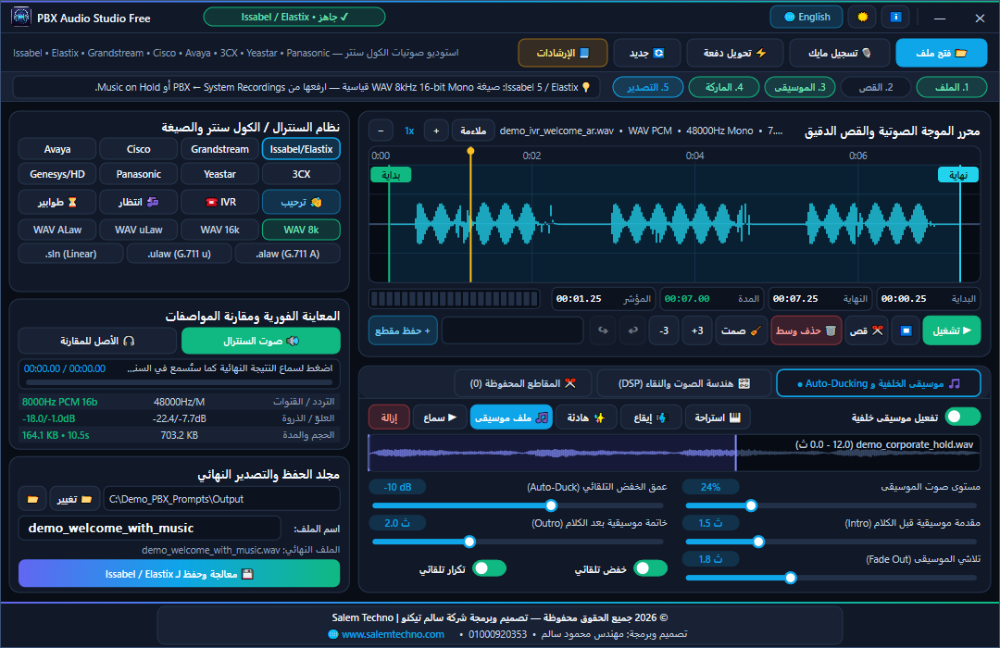
</div>

- **🇪🇬 الشرح بالعربية:**
  - عند تفعيل **`تفعيل موسيقى خلفية`** يمكنك استيراد أي ملف موسيقى خارجي أو توليد مقطوعة مؤسسية مدمجة بضغطة زر (**`هادئة`** / **`إيقاع`** / **`استراحة`**).
  - يعرض التبويب موجة الموسيقى المستقلة (`demo_corporate_hold.wav`) لتحديد الجزء المطلوب منها، مع تحكم دقيق في **مستوى صوت الموسيقى (`24%`)**، **عمق الخفض التلقائي وقت الكلام (`Auto-Duck -10 dB`)**، **المقدمة الموسيقية قبل الكلام (`Intro 1.5s`)**، **الخاتمة بعد الكلام (`Outro 2.0s`)**، **التلاشي (`Fade Out 1.8s`)**، ومفتاحي **`خفض تلقائي`** و**`تكرار تلقائي`**.
- **🇬🇧 English Description:**
  - Mix any custom audio bed or generate built-in royalty-free corporate hold music (**Warm**, **Pulse**, **Lounge**) with its own trim waveform and precision controls for Music Volume, **Auto-Ducking depth during speech**, Intro/Outro padding, Fade Out, and seamless looping.

---

### 🔹 شاشة (`S-06`): تبويب هندسة الصوت والنقاء (`Audio Mastering — DSP`)

<div align="center">
  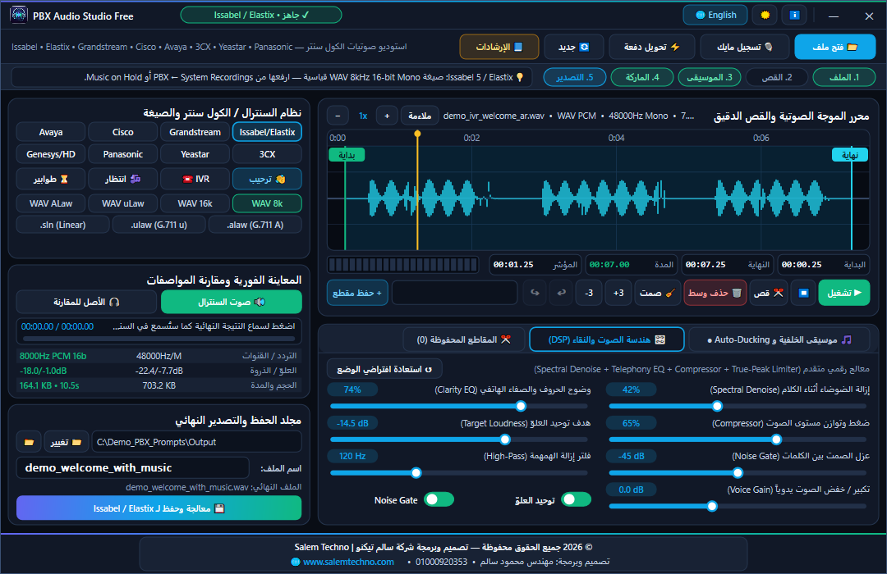
</div>

- **🇪🇬 الشرح بالعربية:**
  - لوحة هندسة صوتية استوديوية كاملة تتيح التحكم الدقيق في سلسلة المعالجة الرقمية:
    - **`إزالة الضوضاء أثناء الكلام (Spectral Denoise)`:** تقنية تحليل طيفي لإزالة صوت المروحة والتكييف والـ Hiss حتى أثناء حديث المعلق.
    - **`وضوح الحروف والصفاء الهاتفي (Clarity EQ)`:** يعوض فقدان الترددات العالية عبر خطوط الهاتف لتظهر الأرقام والحروف بنقاء لافت.
    - **`ضغط وتوازن مستوى الصوت (Compressor)`** + **`هدف توحيد العلوّ (Target Loudness)`** + **`عزل الصمت بين الكلمات (Noise Gate)`** + **`فلتر إزالة الهمهمة (High-Pass 120 Hz)`** + **`تكبير/خفض يدوي`** وزر **`استعادة افتراضي الوضع`**.
- **🇬🇧 English Description:**
  - Full telephony mastering rack featuring **STFT Spectral Noise Reduction**, **Telephony Vocal Clarity EQ (2.35 kHz)**, **Dynamic Soft Compressor**, **Target RMS Loudness**, **Silence Noise Gate**, **Rumble High-Pass Filter**, Manual Gain, and one-click **Reset Preset**.

---

### 🔹 شاشة (`S-07`): تبويب المقاطع المحفوظة (`Saved IVR Clips Manager`)

<div align="center">
  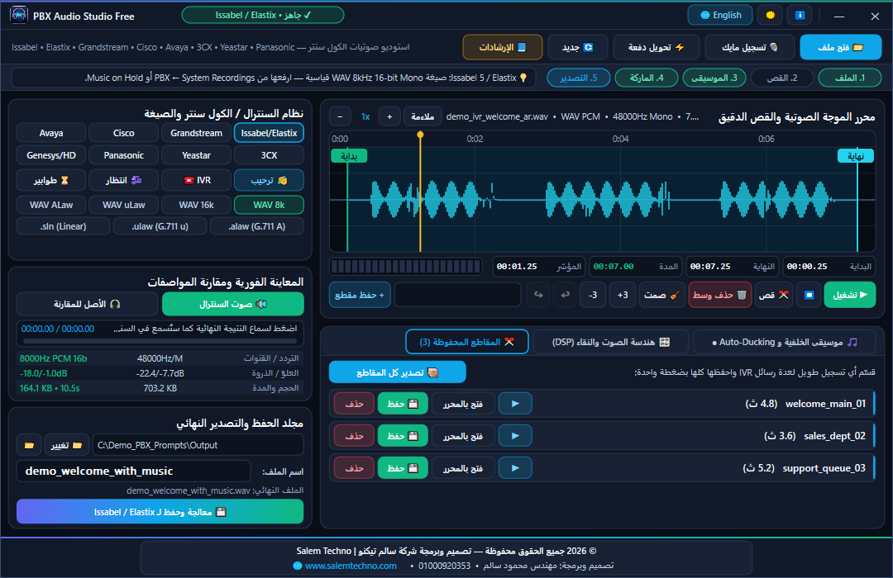
</div>

- **🇪🇬 الشرح بالعربية:**
  - ميزة مثالية لمهندسي الـ IVR: بدلاً من فتح وتصدير كل جملة على حدة، يمكنك تسجيل جميع رسائل القائمة الصوتية في ملف واحد، ثم تحديد كل رسالة والضغط على **`+ حفظ مقطع`** لتُضاف لقائمة المقاطع (`welcome_main_01`، `sales_dept_02`، `support_queue_03`).
  - كل مقطع يملك أزرار تشغيل فوري، فتح بالمحرر، حفظ منفرد، أو حذف — مع زر **`تصدير كل المقاطع`** لتصديرها جميعاً بضغطة واحدة بنفس إعدادات السنترال المختار.
- **🇬🇧 English Description:**
  - Slice a single voiceover session into multiple named IVR prompts (`welcome_main_01`, `sales_dept_02`, `support_queue_03`), audition or reload any clip back into the editor, or export every saved clip at once in one click.

---

### 🔹 شاشة (`S-08`): شريط التقدم الأخضر الحي ونسبة التحويل المئوية (`0% – 100%`) | Live Emerald Conversion Progress

<div align="center">
  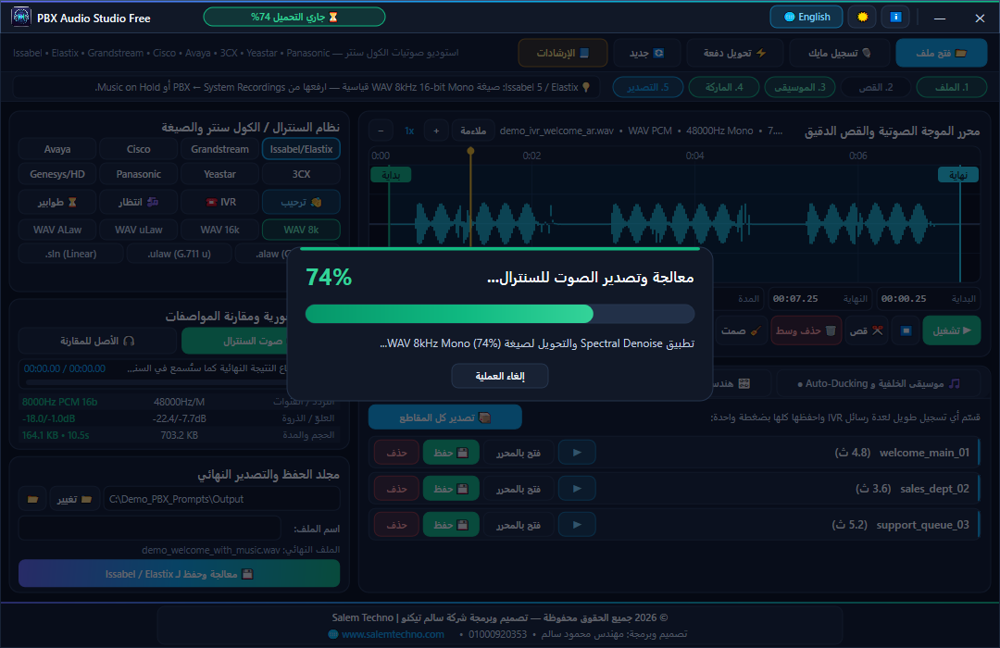
</div>

- **🇪🇬 الشرح بالعربية:**
  - أثناء فتح الملفات الكبيرة أو تطبيق المعالجة الطيفية أو التحويل والتصدير، تظهر بطاقة تقدم احترافية تحتوي على **شريط تحميل أخضر متحرك** مع **نسبة مئوية كبيرة وواضحة (`74%`)** ووصف حي للمرحلة الجارية (بالإضافة إلى تحديث لحظي داخل الشريط العلوي `⏳ جاري التحميل 74%`) وزر **`إلغاء العملية`** الفوري — مع بقاء الواجهة سلسة تماماً بدون أي تجمّد.
- **🇬🇧 English Description:**
  - Non-blocking background worker progress overlay featuring an animated emerald progress bar, bold percentage readout (`74%`), live DSP stage description, synchronized titlebar status pill, and instant **Cancel** support.

---

### 🔹 شاشة (`S-09`): الدليل الشامل المدمج لجميع أنظمة الكول سنتر | Built-In Universal PBX Guide

<div align="center">
  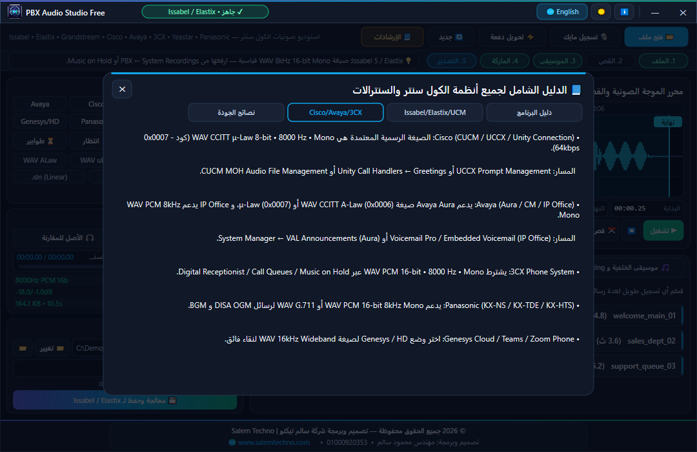
</div>

- **🇪🇬 الشرح بالعربية:**
  - بالضغط على زر **`📘 الإرشادات`** تُفتح موسوعة مدمجة بـ 4 تبويبات تشرح باللغتين العربية والإنجليزية خطوات العمل، والصيغ الرسمية ومسارات الرفع داخل **Issabel / Elastix / Grandstream / Yeastar**، و**Cisco / Avaya / 3CX / Panasonic / Genesys**، ونصائح هندسة الصوت الاحترافية.
- **🇬🇧 English Description:**
  - Click **PBX Guide** anytime to open the 4-tab built-in reference covering studio workflow, exact upload paths & codec specs for **Issabel/Elastix/UCM/Yeastar** and **Cisco/Avaya/3CX/Panasonic/Genesys**, plus pro recording & mastering tips.

---

### 🔹 شاشة (`S-10`): نتائج التحويل الدفعي متعدد الأنوية | Multi-Core Batch Conversion Results

<div align="center">
  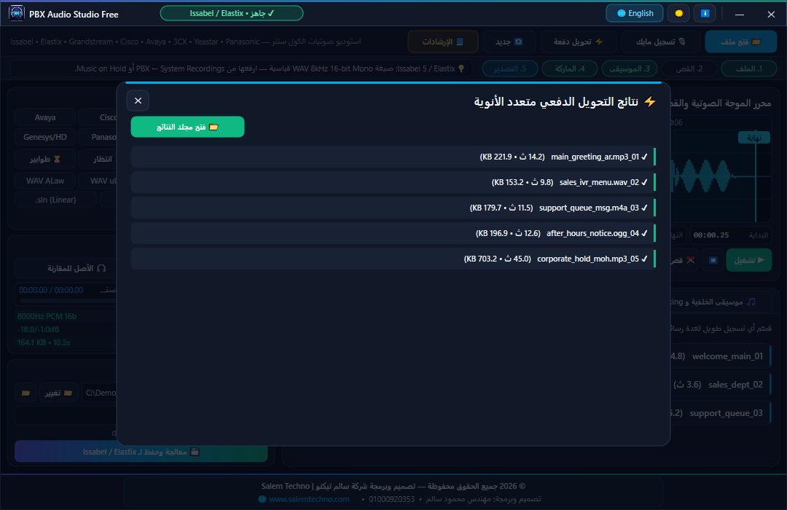
</div>

- **🇪🇬 الشرح بالعربية:**
  - بالضغط على **`⚡ تحويل دفعة`** يمكنك اختيار عشرات الملفات الصوتية دفعة واحدة (`MP3, WAV, M4A, OGG...`) لتحويلها بالتوازي على جميع أنوية المعالج، ثم عرض تقرير منظم بنتيجة كل ملف ومدته وحجمه النهائي مع زر **`📂 فتح مجلد النتائج`** لفتح مجلد المخرجات مباشرة.
- **🇬🇧 English Description:**
  - Select multiple audio files in any supported format to batch-process and convert them in parallel across all CPU cores using your active PBX brand profile, followed by a clear per-file report (status, duration, final byte size) and one-click **Open Output Folder**.

---

### 🔹 شاشة (`S-11`): نافذة «حول البرنامج» وحقوق الملكية | About & Official Copyright Modal

<div align="center">
  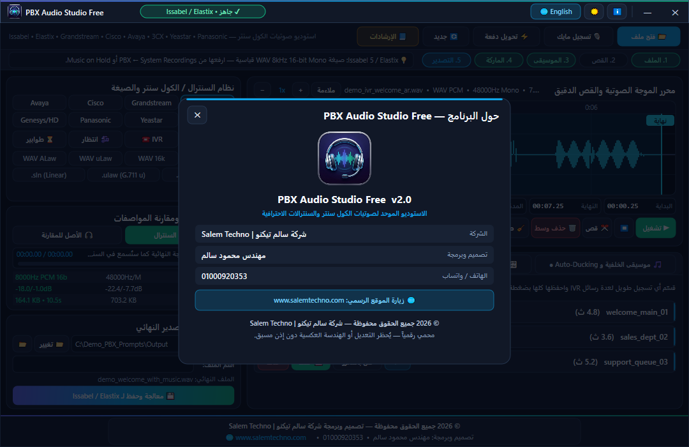
</div>

- **🇪🇬 الشرح بالعربية:**
  - تُفتح من أيقونة **`ℹ`** في الشريط العلوي وتعرض الشعار الرسمي للبرنامج، رقم الإصدار **`PBX Audio Studio Free v2.0`**، بيانات الشركة المطوّرة (**شركة سالم تيكنو | Salem Techno**)، بيانات المصمم والمبرمج (**مهندس محمود سالم — `01000920353`**)، وزر زيارة الموقع الرسمي **`www.salemtechno.com`**.
- **🇬🇧 English Description:**
  - Accessible via the **`ℹ`** button in the slim titlebar, displaying the official emblem, **`PBX Audio Studio Free v2.0`** release info, developer details (**Eng. Mahmoud Salem — Salem Techno**), direct WhatsApp/Phone (`01000920353`), and clickable official website link.

---

<a id="quickstart"></a>
## 🚀 التشغيل السريع واختصارات لوحة المفاتيح | Quick Start & Keyboard Shortcuts

1. **التشغيل الفوري بدون تثبيت:** حمّل ملف [**`PBX Audio Studio Free.exe`**](https://github.com/SalemTechno/PBX-Audio-Studio-Free/raw/main/1_Portable_Edition/PBX%20Audio%20Studio%20Free.exe) وشغّله مباشرة بنقرة مزدوجة.
2. **اختر لغتك:** اضغط **`النسخة العربية`** أو **`English Edition`**.
3. **أضف الصوت:** اسحب أي ملف صوتي وأفلته داخل النافذة، أو اضغط **`فتح ملف`**، أو **`تسجيل مايك`**، أو جرّب **`تحميل صوت تجريبي`**.
4. **اختر ماركة السنترال واضغط حفظ:** اختر ماركة الكول سنتر (`Issabel/Elastix`, `Grandstream`, `Cisco`, `Avaya`, `3CX`, `Yeastar`, `Panasonic`, `Genesys`) ثم اضغط زر الحفظ السفلي ليكون الملف جاهزاً فوراً للرفع!

| الاختصار (Shortcut) | الوظيفة (Action — AR / EN) |
| :---: | :--- |
| **`Space`** | تشغيل / إيقاف المعاينة الصوتية — Play / Stop audio playback |
| **`Ctrl + Z`** | التراجع عن آخر تعديل على الموجة — Undo last waveform edit |
| **`Ctrl + Y`** | إعادة التعديل — Redo waveform edit |
| **`Mouse Wheel`** | تكبير / تصغير الموجة الصوتية بدقة — Precision waveform zoom in / out |
| **`Drag & Drop`** | سحب وإفلات أي ملف صوتي مباشرة للتحميل الفوري — Instant file loading |

---

## 💻 متطلبات التشغيل والأمان | System Requirements & Security Architecture

- **نظام التشغيل (`Operating System`):** Windows 10 / Windows 11 / Windows Server 2016, 2019, 2022, 2025 (64-bit) — يعمل مباشرة فورياً بملف واحد مستقل بدون تثبيت أي حزم أو مشغلات خارجية (`Zero External Dependencies`).
- **الأداء الفائق والخفة (`Ultra-Light Performance`):** إقلاع لحظي واستهلاك ذاكرة ضئيل جداً (~`35 MB RAM` فقط) مع معالجة متعددة الأنوية لتحويل عشرات الملفات في ثوانٍ.
- **الحماية الرقمية (`Digital Integrity Protection`):** الملف التنفيذي محمي رقمياً ببصمة **`SHA-256`** مدمجة للتحقق التلقائي من سلامة النسخة الأصلية ومنع التلاعب أو التعديل غير المصرح به.

---

<a id="contact"></a>
<div align="center">

## 📞 التواصل مع المصمم والمبرمج والدعم الفني
## Contact Developer & Technical Support

**للاستفسارات التقنية أو طلب نسخ مخصصة وحلول أنظمة الكول سنتر والـ IP-PBX للشركات والمؤسسات:**  
**For technical inquiries, custom enterprise audio automation, or corporate IP-PBX solutions:**

<br />

**👨‍💻 تصميم وبرمجة (Designed & Developed by):** **مهندس محمود سالم (Eng. Mahmoud Salem)**  
**🏢 الشركة (Company):** **[شركة سالم تيكنو | Salem Techno](https://www.salemtechno.com)**  
**📞 الهاتف / واتساب (Phone / WhatsApp):** **`01000920353`** (`+201000920353`)  
**🌐 الموقع الرسمي (Official Website):** **[https://www.salemtechno.com](https://www.salemtechno.com)**

<br />

<p align="center">
  <a href="https://wa.me/201000920353">
    
  </a>
  <a href="https://www.salemtechno.com">
    
  </a>
  <a href="https://github.com/SalemTechno/PBX-Audio-Studio-Free/raw/main/1_Portable_Edition/PBX%20Audio%20Studio%20Free.exe">
    
  </a>
</p>

<br />

<sub>© 2026 جميع الحقوق محفوظة — تصميم وبرمجة <b>شركة سالم تيكنو | Salem Techno</b> — مهندس محمود سالم. All Rights Reserved.</sub>

</div>
